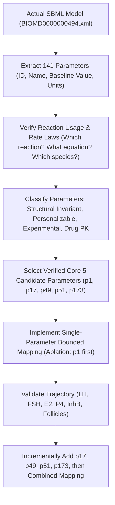
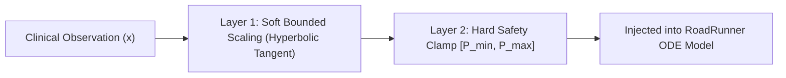

# Implementation Plan: Röblitz Parameter Mapping (Phase 7)
## Phenotype-Informed Kinetic Parameter Personalization

**Document Version:** 2.0.0 (Revised per Expert Biological & Numerical Review)  
**Target Milestone:** Phase 7 — Röblitz Parameter Mapping  
**Project:** OvaTwin (Hybrid AI + Physiological Digital Twin for PCOS)  
**Status:** Pre-implementation Planning (Approved Strategy, No Code Implemented Yet)  

---

## 1. Executive Summary & Revised Strategy

In OvaTwin, the physiological modeling branch is powered by the **Röblitz et al. 2013 mathematical model** of the human menstrual cycle (`BIOMD0000000494`), a stiff system of ordinary differential equations (ODEs) comprising 46 state variables, 141 global parameters, and complex feedback loops across the Hypothalamic-Pituitary-Ovarian (HPO) axis.

Following scientific review, the implementation strategy for Phase 7 is revised with the following core principles:

1. **Source of Truth First:** We do not assume parameter names, values, or biological functions. We extract the complete parameter registry and their governing mathematical reaction equations directly from the active SBML (`models/BIOMD0000000494.xml`) before any mapping code is written.
2. **Phenotype-Informed Mapping vs. Direct Measurement:** Clinically observed circulating hormones (e.g. serum LH) are **emergent system state variables**, not direct measurements of kinetic parameters. We treat parameter mapping as *phenotype-informed parameter personalization* designed to bias the model toward a patient's endocrine state, not as a claim that serum LH directly equals the pituitary synthesis rate.
3. **Incremental Ablation Strategy (Start with 1, then a 5-Parameter Core):** Rather than personalizing 10 parameters simultaneously, we start by personalizing exactly **one parameter** (`p1` / `b_syn_LH`), validating its trajectory against the baseline. We then expand incrementally to a core subset of **5 verified parameters** (`p1`, `p17`, `p49`, `p51`, `p173`) before testing any combined personalization.
4. **Two-Layer Parameter Bounds:** We separate soft bounded perturbations (e.g., $\pm 20\%$ to $\pm 40\%$ via hyperbolic tangent scaling) from hard physiological safety clamps ($0.4\times$ to $2.5\times$ baseline).
5. **No Silent Solver Fallbacks:** If RoadRunner/CVODE encounters stiff integration failure (especially noted around day ~91), the system captures the diagnostic error explicitly (`SimulationResult(success=False, ...)`) rather than silently altering parameters.
6. **Baseline Preservation Invariance:** Any patient with missing data or mapping disabled must mathematically reproduce the exact generic baseline simulation trajectory ($0.0$ deviation across all 46 species).

---

## 2. Parameter Workflow & Source of Truth

Before coding any mapping formulas, the workflow strictly proceeds through five analytical gates:



---

## 3. Parameter Classification & Core 5 Candidates

### 3.1 Parameter Classification Hierarchy
1. **Structural Invariants (NEVER Personalize):**
   - Receptor association/dissociation/inactivation rates ($k_{on}, k_{off}, k_{inact}$ for GnRH, LH, FSH receptors).
   - Circulating blood volume constant ($V_{blood} = 5.0\text{ L}$, parameter `p12`).
   - Pharmacokinetic drug constants (GnRH agonist/antagonist parameters `p269`–`p514`).
   - Universal Hill cooperativity exponents ($n_{E2}, n_{P4}, n_{IhA}$).
2. **Personalizable Candidates (Tier 1 Core — Phase 7 Scope):**
   - A conservative subset of 5 parameters governing key pituitary synthesis/release, early follicular recruitment, and dominant follicle selection.
3. **Exploratory Candidates (Tier 2 — Future Calibration Scope):**
   - Basal steroidogenesis rates (`b_E2` / `p158`, `b_P4` / `p166`, `b_rel_LH` / `p16`, `k_AF1_AF2` / `p50`). Deferred until Phase 8 (Patient-Specific Calibration).

### 3.2 Tier 1 Core Candidates (To Be Verified in SBML Reactions)

| Parameter ID | BioModels Symbol | Baseline Value | Reaction / Rate Law Role | Linked Clinical Observations | Cautious Physiological Rationale |
| :--- | :--- | :--- | :--- | :--- | :--- |
| **`p1`** | `b_syn_LH` | `7309.9159` | Pituitary LH synthesis rate | Serum LH, Computed FSH/LH ratio | Candidate parameter to represent altered pituitary LH synthesis associated with elevated circulating LH and high LH:FSH ratio. |
| **`p17`** | `b_rel_FSH` | `0.056989` | Pituitary FSH basal release rate | Serum FSH, Computed FSH/LH ratio | Candidate parameter representing relative FSH release dynamics in the presence of altered gonadotropin balance. |
| **`p49`** | `k_AF1` | `3.661804` | Early follicular recruitment rate | Total Follicle Count, AMH | Candidate parameter representing the rate of primordial/pre-antral entry into the early antral follicle pool ($AF1$). |
| **`p51`** | `k_AF2_AF3` | `4.882316` | Transition to larger antral stage ($AF2 \to AF3$) | Cycle regularity, Mean follicle size | Candidate parameter representing follicular selection efficiency; reduced in anovulatory arrest where selection is impaired. |
| **`p173`** | `b_IhB` | `89.493467` | Basal Inhibin B synthesis | Total Follicle Count, AMH | Candidate parameter representing cumulative Inhibin B output produced by the expanded pool of small antral follicles. |

---

## 4. Mathematical Mapping Formulations

### 4.1 Two-Layer Bounded Scaling Architecture
To reduce the risk of numerical instability in the stiff CVODE solver, parameter adjustments pass through two protective tiers:



#### Layer 1: Soft Bounded Scaling Function
$$S(x; x_{ref}, \Delta_{max}, \alpha) = 1.0 + \Delta_{max} \cdot \tanh\left( \alpha \cdot \frac{x - x_{ref}}{x_{ref}} \right)$$

- When $x = x_{ref}$, $S = 1.0$ (exact baseline preserved).
- As $x \to \infty$, $S \to 1.0 + \Delta_{max}$.
- As $x \to 0$, $S \to 1.0 - \Delta_{max} \cdot \tanh(\alpha)$.
- Bounded perturbation range: $[1 - \Delta_{max}, 1 + \Delta_{max}]$. For $\Delta_{max} = 0.35$, the parameter perturbation is strictly limited to $\pm 35\%$ ($0.65\times$ to $1.35\times$ baseline).

#### Layer 2: Hard Safety Clamping
$$P_{final} = \max\left( P_{hard\_min}, \min\left( P_{base} \cdot S(x), P_{hard\_max} \right) \right)$$
- Parameter-specific limits (e.g., $P_{hard\_min} = 0.40 \times P_{base}$, $P_{hard\_max} = 2.00 \times P_{base}$).
- Guarantees $P_{final} > 0$ under all circumstances.

### 4.2 Multi-Signal Gonadotropin Mapping
Rather than relying on a single ratio, we utilize **three distinct clinical signals**:
1. Serum LH (absolute level)
2. Serum FSH (absolute level)
3. Self-computed FSH/LH ratio (derived explicitly in code to bypass corrupted `#NAME?` spreadsheet cells and extreme lab artifacts).

---

## 5. Architectural Design & Code Organization

The authoritative parameter registry will reside directly in `src/HPO/parameters.py`, while mapping and digital twin integration reside in `src/twin/`:

```text
src/
├── HPO/
│   ├── parameters.py               <-- Authoritative Röblitz parameter registry (141 parameters)
│   ├── model_runner.py             <-- RoadRunner execution engine
│   ├── patient_values.py           <-- HPOPatientValues (541 clinical records)
│   └── baseline_simulation.py      <-- Baseline trajectory execution
│
└── twin/
    ├── roblitz_mapping.py          <-- Bounded scaling functions & parameter-specific mappers
    ├── parameter_mapping.py        <-- PatientTwinMapping updated with ode_parameters
    ├── digital_twin.py             <-- PatientDigitalTwin personalized baseline & scenarios
    └── scenarios.py                <-- ScenarioSimulator parameter override engine
```

### 5.1 Authoritative Registry Design (`src/HPO/parameters.py`)
Will contain:
- Complete dictionary mapping SBML IDs (`p1`, `p2`, ..., `p514`) $\leftrightarrow$ BioModels names (`b_syn_LH`, `b_rel_FSH`, ...).
- Published baseline values extracted directly from the SBML model.
- Classification category tags (`STRUCTURAL`, `PERSONALIZABLE_CORE`, `EXPLORATORY`, `DRUG_PK`).
- Parameter-specific safety bounds $[hard\_min, hard\_max]$.

---

## 6. Defensive Safety & Solver Failure Protocol

### 6.1 Missing Data Handling (Explicit & Logged)
If a clinical marker is missing (`None` or `NaN`):
1. The mapped parameter remains strictly at its published baseline value.
2. The decision is logged for auditing:
   ```text
   [MAPPING LOG] Patient 104 | Parameter p173 (b_IhB) | Input: missing | Assigned: baseline (89.49) | Reason: unobserved clinical marker
   ```

### 6.2 No Silent Fallbacks on Numerical Failure
The Röblitz model exhibits known numerical stiffness around Day 91. If RoadRunner or CVODE throws an integration warning or failure:
- The system **MUST NOT** silently alter parameters or substitute a generic baseline.
- It returns an explicit failure state:
  ```python
  @dataclass
  class SimulationResult:
      success: bool
      error_message: Optional[str] = None
      parameters_used: dict[str, float] = field(default_factory=dict)
      trajectory: Optional[Any] = None
  ```
- This ensures full transparency for debugging and clinical validation.

### 6.3 Baseline Preservation Invariance
A dedicated verification test will assert:
$$\text{Twin}(\text{empty observations}).\text{run\_baseline}() \equiv \text{RoblitzModelRunner}().\text{simulate}()$$
The maximum trajectory delta between an unpersonalized twin and the generic baseline must be exactly `0.0`.

---

## 7. Phased Implementation Sequence (Ablation-First Roadmap)

Once coding commences, development will proceed strictly in 10 sequential steps:

- **Step 7.1 — Extract & Verify SBML Parameter Registry:**
  Script-driven extraction of all 141 parameters directly from `models/BIOMD0000000494.xml`, verifying ID $\leftrightarrow$ Name $\leftrightarrow$ Value $\leftrightarrow$ Units.
- **Step 7.2 — Verify Governing Reaction Equations:**
  For each of the 5 candidates, inspect the kinetic rate law in the SBML to verify the exact mathematical role and which species are affected.
- **Step 7.3 — Classify Parameters in `src/HPO/parameters.py`:**
  Build the authoritative parameter registry with category tags and safety bounds.
- **Step 7.4 — Implement Generic Bounded Mapping Function:**
  In `src/twin/roblitz_mapping.py`, implement `bounded_scale(value, reference, max_delta, alpha)` with unit tests for bounds, clamps, and `None` handling.
- **Step 7.5 — Implement Single-Parameter Mapping (`p1` / `b_syn_LH`):**
  Implement the mapping function for `p1` only.
- **Step 7.6 — Run Single-Parameter Ablation (`p1`):**
  Simulate Patient #1 with `p1`-personalization only vs. generic baseline. Analyze LH trajectory delta.
- **Step 7.7 — Trajectory Sanity & Solver Check:**
  Confirm 0 CVODE integration crashes, positive concentrations, and physiological plausibility.
- **Step 7.8 — Add Second Parameter (`p17` / `b_rel_FSH`):**
  Test `p17` alone, then `p1 + p17` jointly.
- **Step 7.9 — Add Follicular Parameters (`p49`, `p51`, `p173`):**
  Incrementally add and test `k_AF1`, `k_AF2_AF3`, and `b_IhB` one-by-one.
- **Step 7.10 — Combined Core Mapping & Cohort Verification:**
  Run the combined 5-parameter mapper across all 541 patients in the clinical dataset, logging distribution statistics and zero crashes.
